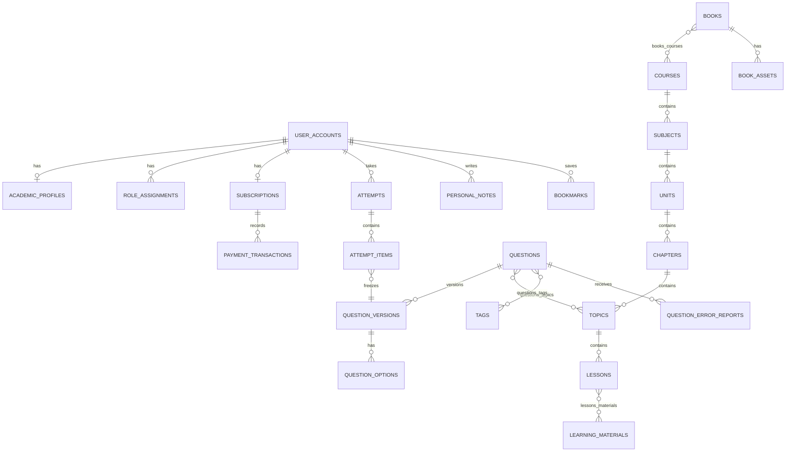

# Nursilo — Database Design

| Field | Value |
| --- | --- |
| Document | `06-database-design.md` |
| Version | `1.0.0` |
| Status | **Approved** — locked database design |
| Product | Nursilo |
| Depends on | [`05-domain-model.md`](05-domain-model.md) (Approved v1.0.0), [`04-system-architecture.md`](04-system-architecture.md) |
| Purpose | PostgreSQL logical database design for Nursilo V1 |
| Out of scope | Django models, migration files, ORM code, API payloads, SQL DDL scripts |

---

## 1. Purpose

This document translates the approved Domain Model into a **PostgreSQL-oriented logical schema**: tables, keys, junctions, versioning, soft delete, multilingual strategy, audit/analytics/search projections, constraints, indexes, and naming conventions.

It does **not** include Django model classes or migration code.

**Engine:** PostgreSQL  
**Runtime shape:** Modular monolith (one primary database)

---

## 2. Design Principles (Schema Level)

| Principle | Schema implication |
| --- | --- |
| Aggregate-aligned tables | Tables cluster around roots; avoid mega-rows of unrelated graphs |
| Attempt integrity | `attempt_items` reference `question_versions`, not mutable question head alone |
| Soft delete | `is_archived` / `archived_at` (and optional `deleted_at` for true soft-delete) on catalog tables |
| Multilingual without table duplication | Translation tables or JSONB locale maps—**not** `questions_bn` / `questions_en` clones |
| M:N via junctions | Explicit join tables for topics↔questions, lessons↔materials, books↔courses |
| Read models separated | Analytics/search tables are projections, rebuildable |
| Audit append-only | `audit_events` has no update/delete path in application policy |
| Naming consistency | See §14 |

---

## 3. Naming Conventions

| Object | Convention | Example |
| --- | --- | --- |
| Tables | `snake_case`, plural | `question_versions` |
| Columns | `snake_case` | `created_at` |
| Primary keys | `id` (UUID recommended) or `<table_singular>_id` only if legacy needed | `id UUID` |
| Foreign keys | `<referenced_singular>_id` | `question_id` |
| Junction tables | `<left_plural>_<right_plural>` alphabetical or ownership-first | `questions_topics` |
| Booleans | `is_` / `has_` prefix | `is_archived`, `is_premium` |
| Timestamps | `*_at` timestamptz | `published_at` |
| Enums | PostgreSQL ENUM or check-constrained text | `editorial_state` |
| Locale codes | `bn`, `en` | `locale` |

**Recommended PK type:** UUID (`gen_random_uuid()`) for public-facing and distributed-safe identities. Bigserial acceptable for pure internal high-volume append tables if preferred later—V1 baseline uses UUID for domain entities unless noted.

---

## 4. Soft Delete / Archive Strategy

| Pattern | Columns | Learner visibility |
| --- | --- | --- |
| **Archive (default for catalog)** | `is_archived BOOLEAN NOT NULL DEFAULT FALSE`, `archived_at TIMESTAMPTZ NULL` | Hidden when `is_archived` OR editorial not Published |
| **Editorial state** | `editorial_state` | Only `published` visible to students |
| **Hard delete** | Not used for questions, books, learning materials, attempts in V1 app flows | N/A |

**Queries for learners** always filter: `editorial_state = 'published' AND is_archived = FALSE` (plus entitlement rules in services).

Historical `attempts` / `attempt_items` are **never** cascaded away when a question is archived.

---

## 5. Multilingual Schema Strategy

**Chosen approach (no duplicated domain tables):**

### 5.1 Translation child tables (preferred for long text)

For stems, explanations, lesson bodies, book blurbs, CMS bodies:

```text
questions (identity + non-localized attrs)
question_translations (question_id, locale, stem, explanation, …)
  UNIQUE (question_id, locale)
```

Same pattern: `learning_material_translations`, `lesson_translations`, `book_translations`, `cms_page_translations`, `blog_post_translations`, `question_version_translations` (version-scoped content).

### 5.2 Locale on rows where inherently monolingual metadata

- `questions.primary_locale` (filter hint)  
- UI strings remain in application catalogs, not DB (except CMS)

### 5.3 Fallback

Application reads requested locale; if missing, falls back to `en` then `bn` (policy in services)—schema only enforces uniqueness per locale.

---

## 6. ERD (Logical)



---

## 7. Table Inventory

### 7.1 Identity & access

| Table | Purpose |
| --- | --- |
| `user_accounts` | Auth identity, basic profile, UI locale |
| `academic_profiles` | Program, institution, semester/year, graduation year, study goal |
| `roles` | Role catalog (super_admin, admin, editor, reviewer, author, student) |
| `role_assignments` | User↔role |

### 7.2 Entitlements & billing

| Table | Purpose |
| --- | --- |
| `subscriptions` | Effective subscription state per user |
| `payment_transactions` | Gateway payments + verification |
| `entitlement_grants` | Optional explicit capability grants/periods |

### 7.3 Learning catalog

| Table | Purpose |
| --- | --- |
| `courses` | Top-level programs |
| `subjects` | Under course |
| `units` | Under subject |
| `chapters` | Under unit |
| `topics` | Under chapter |
| `lessons` | Under topic |
| `learning_materials` | Reusable materials |
| `lessons_learning_materials` | M:N junction |
| `lessons_subjects` | Optional extra M:N when academically needed |
| `*_translations` | Locale-specific text for learning entities |
| `learner_progress` | Per-user lesson/topic progress |
| `continue_learning_cursors` | Last position |

### 7.4 Assessment catalog

| Table | Purpose |
| --- | --- |
| `questions` | Stable question aggregate identity |
| `question_versions` | Immutable (append-only) scored content revisions |
| `question_version_translations` | Localized stem/explanation per version |
| `question_options` | Options belonging to a version |
| `question_option_translations` | Localized option text |
| `tags` | Tag catalog |
| `questions_tags` | M:N |
| `questions_topics` | M:N |
| `questions_courses` | **Optional only** — optimization/denormalized aid if retained; **not** the primary academic path. Primary relationship remains Question → Topic → Chapter → Subject → Course via `questions_topics` and the hierarchy |
| `exam_definitions` | Exam/mock blueprints |
| `exam_definition_items` / rules tables | Pool configuration |
| `practice_templates` | V1.1 saved custom templates (nullable in V1 schedule) |
| `question_error_reports` | Learner reports |

### 7.5 Assessment runtime

| Table | Purpose |
| --- | --- |
| `attempts` | Practice/exam attempts |
| `attempt_items` | Per-question slots with version refs + answers + results |

### 7.6 Library

| Table | Purpose |
| --- | --- |
| `books` | Book catalog |
| `book_translations` | Localized metadata/blurb |
| `book_assets` | PDF/EPUB/HTML/image assets (storage keys, not public URLs as sole auth) |
| `books_courses` | M:N |
| `books_subjects` | Optional M:N |

### 7.7 Engagement

| Table | Purpose |
| --- | --- |
| `personal_notes` | Learner notes |
| `bookmarks` | Learner bookmarks |
| `study_goals` | Daily goals |
| `study_streaks` | Streak state |

### 7.8 Notifications & CMS

| Table | Purpose |
| --- | --- |
| `notifications` | In-app notifications |
| `announcements` | Announcements |
| `announcement_translations` | Localized announcement body |
| `cms_pages` | Landing/marketing pages |
| `cms_page_translations` | Localized page content + SEO fields |
| `blog_posts` | Blog |
| `blog_post_translations` | Localized post content + SEO |
| `contact_messages` | Contact/feedback |

### 7.9 Platform

| Table | Purpose |
| --- | --- |
| `platform_settings` | Key/value settings |
| `feature_toggles` | Named toggles |
| `audit_events` | Append-only audit |

### 7.10 Search projections

| Table | Purpose |
| --- | --- |
| `search_documents` | Unified search projection rows |

### 7.11 Analytics read models

| Table | Purpose |
| --- | --- |
| `learner_topic_stats` | Weak/strong topic aggregates |
| `question_usage_stats` | Attempt count, accuracy, trends |
| `content_performance_stats` | Admin content engagement |

---

## 8. Core Table Definitions (Logical Columns)

> Types are logical PostgreSQL types. Not Django fields.

### 8.1 `user_accounts`

| Column | Type | Notes |
| --- | --- | --- |
| `id` | UUID PK | |
| `email` | CITEXT UNIQUE NOT NULL | |
| `password_hash` | TEXT NOT NULL | |
| `full_name` | TEXT | |
| `ui_locale` | VARCHAR(5) | `bn`/`en` |
| `is_active` | BOOLEAN | |
| `created_at`, `updated_at` | TIMESTAMPTZ | |

**FK:** none required  
**Indexes:** unique(`email`); (`is_active`)

### 8.2 `academic_profiles`

| Column | Type | Notes |
| --- | --- | --- |
| `id` | UUID PK | |
| `user_id` | UUID UNIQUE FK → user_accounts | |
| `academic_program` | TEXT | |
| `institution` | TEXT | |
| `current_semester_year` | TEXT | |
| `expected_graduation_year` | INT NULL | |
| `current_study_goal` | TEXT NULL | |

### 8.3 `roles` / `role_assignments`

`roles(id, code UNIQUE, name)`  
`role_assignments(id, user_id FK, role_id FK, assigned_at, assigned_by)`  
**UNIQUE** (`user_id`, `role_id`)

### 8.4 `subscriptions`

| Column | Type | Notes |
| --- | --- | --- |
| `id` | UUID PK | |
| `user_id` | UUID UNIQUE FK | One effective row V1 (history via payments/grants) |
| `state` | TEXT CHECK | `free`, `pending_payment`, `premium_active`, `expired`, `revoked` |
| `premium_started_at` | TIMESTAMPTZ NULL | |
| `premium_expires_at` | TIMESTAMPTZ NULL | |
| `updated_at` | TIMESTAMPTZ | |

### 8.5 `payment_transactions`

| Column | Type | Notes |
| --- | --- | --- |
| `id` | UUID PK | |
| `user_id` | UUID FK | |
| `subscription_id` | UUID FK | |
| `gateway` | TEXT | `bkash`, `nagad`, `sslcommerz` |
| `gateway_ref` | TEXT | Idempotency key |
| `amount`, `currency` | NUMERIC, TEXT | |
| `status` | TEXT | `initiated`, `confirmed`, `failed` |
| `raw_event_fingerprint` | TEXT | No secrets |
| `created_at`, `confirmed_at` | TIMESTAMPTZ | |

**UNIQUE** (`gateway`, `gateway_ref`) for idempotency.

### 8.6 Learning hierarchy tables

Shared catalog columns pattern:

| Column | Notes |
| --- | --- |
| `id` UUID PK | |
| Parent FK | e.g. `course_id`, `subject_id`, … |
| `sort_order` INT | |
| `editorial_state` TEXT CHECK | draft/review/approved/published/archived |
| `is_archived` BOOLEAN | |
| `archived_at` | |
| `published_at` | |
| `created_at`, `updated_at` | |

Tables: `courses`, `subjects`, `units`, `chapters`, `topics`, `lessons`.

Translation example `course_translations(id, course_id, locale, title, summary, UNIQUE(course_id,locale))`.

### 8.7 `learning_materials` + `lessons_learning_materials`

`learning_materials`: identity + editorial + archive + `is_premium` optional  
`lessons_learning_materials(lesson_id, learning_material_id, sort_order, PRIMARY KEY(lesson_id, learning_material_id))`

### 8.8 `questions`

| Column | Type | Notes |
| --- | --- | --- |
| `id` | UUID PK | Stable aggregate id |
| `question_type` | TEXT CHECK | mcq, true_false, best_answer, clinical_scenario, image_based |
| `difficulty` | TEXT CHECK | easy, medium, hard, expert |
| `primary_locale` | VARCHAR(5) | |
| `editorial_state` | TEXT | |
| `current_version_id` | UUID NULL FK → question_versions | Head pointer |
| `is_archived` | BOOLEAN | |
| `reference_citation` | TEXT | |
| `created_at`, `updated_at` | | |

### 8.9 `question_versions` (versioning)

| Column | Type | Notes |
| --- | --- | --- |
| `id` | UUID PK | Version identity |
| `question_id` | UUID FK → questions | |
| `version_no` | INT NOT NULL | Monotonic per question |
| `clinical_scenario_body` | TEXT NULL | Or in translations |
| `media_asset_key` | TEXT NULL | Storage key |
| `correct_answer_spec` | JSONB | Structured correctness |
| `created_at` | TIMESTAMPTZ | |
| `created_by` | UUID NULL FK users | |

**UNIQUE** (`question_id`, `version_no`)  
**Immutability policy:** no updates to scored fields after any `attempt_items` reference the version (enforce in services; optional DB trigger later).

`question_version_translations(version_id, locale, stem, explanation, UNIQUE(version_id,locale))`  
`question_options(id, question_version_id, key, is_correct, sort_order)`  
`question_option_translations(option_id, locale, label, UNIQUE(option_id,locale))`

### 8.10 Junctions for questions

`questions_topics(question_id, topic_id, PRIMARY KEY(...))`  
`questions_tags(question_id, tag_id, PRIMARY KEY(...))`

### 8.11 `attempts` / `attempt_items`

**`attempts`**

| Column | Notes |
| --- | --- |
| `id` UUID PK | |
| `user_id` FK | |
| `mode` | practice, chapter_exam, subject_exam, timed_exam, mock, custom |
| `state` | not_started, in_progress, submitted, completed |
| `scope_type`, `scope_id` | Nullable polymorphic scope |
| `exam_definition_id` | Nullable FK |
| `time_limit_seconds`, `started_at`, `expires_at`, `completed_at` | Timer |
| `score_summary` JSONB | |
| `created_at` | |

**`attempt_items`**

| Column | Notes |
| --- | --- |
| `id` UUID PK | |
| `attempt_id` FK | |
| `position` INT | |
| `question_id` FK | Convenience |
| `question_version_id` FK NOT NULL | Integrity |
| `selected_answer` JSONB | |
| `is_correct` BOOLEAN NULL | |
| `answered_at` | |

**Indexes:** (`user_id`, `created_at` DESC); (`attempt_id`, `position`); (`question_version_id`)

### 8.12 `books` / `book_assets` / `books_courses`

`books`: metadata + editorial + `is_premium` + archive  
`book_assets(id, book_id, format CHECK IN (pdf,epub,html,image), storage_key, sort_order)`  
`books_courses(book_id, course_id, PK)`

### 8.13 Engagement tables

`personal_notes(id, user_id, target_type, target_id, body, timestamps)`  
`bookmarks(id, user_id, target_type, target_id, UNIQUE(user_id,target_type,target_id))`  
`study_goals`, `study_streaks` keyed by `user_id`

### 8.14 Notifications / CMS

`notifications(id, user_id, kind, title, body, is_read, created_at)`  
`announcements(...)` + translations  
`cms_pages`, `blog_posts` + translations including `meta_title`, `meta_description`, `slug` (slug unique per locale or global policy)  
`contact_messages(id, user_id NULL, email, subject, body, status, created_at)`

### 8.15 Platform

`platform_settings(key PRIMARY KEY, value JSONB, updated_at, updated_by)`  
`feature_toggles(code PRIMARY KEY, is_enabled, updated_at)`  
`audit_events(id, actor_user_id, action, target_type, target_id, metadata JSONB, created_at)`  
**No updated_at** on audit; append-only.

---

## 9. Versioning Tables (Summary)

| Table | Role |
| --- | --- |
| `questions` | Stable ID + `current_version_id` |
| `question_versions` | Append-only scored revision |
| `question_version_translations` / options | Version-scoped content |
| `attempt_items.question_version_id` | Freezes what the learner saw |

Optional future: `learning_material_versions`—not required for V1 if materials are not scored; questions are mandatory to version.

---

## 10. Audit Schema

`audit_events` columns as above.

**Mandatory action codes (examples):** `login_success`, `login_failure`, `role_changed`, `content_published`, `question_edited`, `question_version_created`, `subscription_changed`, `payment_confirmed`, `settings_changed`.

**Indexes:** (`created_at` DESC); (`actor_user_id`, `created_at`); (`action`, `created_at`); (`target_type`, `target_id`)

---

## 11. Analytics Read-Model Tables

### 11.1 `learner_topic_stats`

| Column | Notes |
| --- | --- |
| `user_id`, `topic_id` | PK composite |
| `attempt_count`, `correct_count` | |
| `accuracy_rate` | NUMERIC |
| `last_attempted_at` | |
| `updated_at` | |

### 11.2 `question_usage_stats`

| Column | Notes |
| --- | --- |
| `question_id` PK | |
| `attempt_count`, `correct_count`, `accuracy_rate` | |
| `difficulty_trend` JSONB | Optional time buckets |
| `updated_at` | |

### 11.3 `content_performance_stats`

| Column | Notes |
| --- | --- |
| `content_type`, `content_id` | Composite PK |
| `views_or_starts`, `completions` | |
| `updated_at` | |

Rebuildable from `attempts` / progress events; not source of truth.

---

## 12. Search Projection Tables

### 12.1 `search_documents`

| Column | Notes |
| --- | --- |
| `id` UUID PK | |
| `entity_type` | course, book, lesson, question, author |
| `entity_id` UUID | |
| `locale` | |
| `title` | |
| `body_text` | Searchable excerpt |
| `is_published` | |
| `is_archived` | |
| `is_premium` | Teaser logic aid |
| `search_vector` | TSVECTOR (generated/maintained) |
| `updated_at` | |

**UNIQUE** (`entity_type`, `entity_id`, `locale`)  
**Index:** GIN(`search_vector`); (`entity_type`); (`is_published`, `is_archived`)

Populated by sync projectors on publish/archive events (V1).

---

## 13. Constraints (Cross-Cutting)

| Constraint type | Examples |
| --- | --- |
| PK | Every table |
| FK | Parent hierarchy; attempt_items → question_versions |
| UNIQUE | email; (question_id, version_no); (gateway, gateway_ref); translation (parent, locale) |
| CHECK | editorial_state, difficulty, question_type, attempt state/mode, subscription state, book format |
| NOT NULL | Critical FKs such as `attempt_items.question_version_id` |

**Application-enforced (documented):** immutability of referenced question versions; entitlement rules; RBAC.

---

## 14. Indexing Strategy

| Area | Indexes |
| --- | --- |
| Auth | unique email |
| Hierarchy | parent_id + sort_order; editorial_state + is_archived |
| Questions | difficulty; question_type; current_version_id; GIN optional on tags via junction |
| Junctions | both FK directions |
| Attempts | (user_id, created_at DESC); state; exam_definition_id |
| Attempt items | attempt_id; question_id; question_version_id |
| Payments | (gateway, gateway_ref) unique; user_id |
| Subscriptions | state; premium_expires_at |
| Search | GIN search_vector |
| Audit | created_at, actor, action |
| Stats | updated_at for incremental jobs |

Avoid over-indexing write-heavy columns until measured; V1 includes the above baseline.

---

## 15. Media / Asset Storage Keys (DB Aspect)

Tables store **`storage_key`** (and metadata), not authorization. Access is mediated by services. Optional `media_assets` registry:

| Column | Notes |
| --- | --- |
| `id` | |
| `storage_key` UNIQUE | |
| `content_type` | |
| `byte_size` | |
| `created_by` | |
| `is_archived` | |

Referenced by `book_assets.media_asset_id` / question version media.

---

## 16. Exam Definitions (Catalog)

`exam_definitions(id, code, title_key, mode, time_limit_seconds, is_premium, editorial_state, track_code NULL)`  
`track_code` examples: `licensing`, `govt_job`, `nclex`, `prometric`  
`exam_definition_rules` JSONB or child table for blueprint filters (topic set, difficulty mix, count).

---

## 17. Mapping Domain Aggregates → Tables

| Aggregate root | Primary tables |
| --- | --- |
| UserAccount | `user_accounts`, `academic_profiles`, `role_assignments` |
| Subscription | `subscriptions`, `payment_transactions` |
| Course (hierarchy) | `courses`…`lessons`, translations, junctions |
| LearningMaterial | `learning_materials`, translations |
| Question | `questions`, `question_versions`, options, translations, junctions |
| Attempt | `attempts`, `attempt_items` |
| Book | `books`, `book_assets`, `books_courses` |
| PersonalNote / Bookmark | `personal_notes`, `bookmarks` |
| Notification / Announcement | `notifications`, `announcements` |
| CmsPage / BlogPost | `cms_pages`, `blog_posts` + translations |
| AuditEvent | `audit_events` |

---

## 18. What Remains Outside This Document

- Django `models.py`
- Migration files
- Exact SQL DDL scripts (optional later in `/database`)
- Redis cache schemas
- Application service implementation

Future partitioning guidance for large append-only tables is documented conceptually in §26 (not a V1 implementation requirement).

---

## 19. Optimistic Concurrency (Editable Catalog)

Mutable catalog tables (learning hierarchy nodes, learning materials, questions head row, books, CMS entities, exam definitions, etc.) should support **optimistic concurrency** so concurrent staff edits do not silently overwrite each other.

| Guidance | Meaning |
| --- | --- |
| Mechanism | A monotonic `version_number` (or equivalent concurrency token) on the editable row |
| Update rule | Services update only when the submitted token matches the stored token, then increment |
| Conflict | On mismatch, reject the write and require reload/retry |
| Scope | Applies to mutable catalog heads—not to append-only `question_versions`, `attempts`, `attempt_items`, `audit_events`, or confirmed payment rows |

`question_versions` remain append-only for scored content; concurrency for “edit question” is expressed by creating a new version under service rules, while the `questions` head row may still use `version_number` for non-scored head metadata / `current_version_id` pointer updates.

---

## 20. Standard Timestamp and Actor Columns

For **mutable** tables, use this convention:

| Column | Purpose |
| --- | --- |
| `created_at` | Row creation time (timestamptz) |
| `updated_at` | Last mutation time (timestamptz) |
| `created_by` | Acting user id (nullable only where system-generated) |
| `updated_by` | Last acting user id |

**Exclusions (append-only / log-like):** `audit_events`, `payment_transactions` (after terminal confirmation policy), `question_versions` (no in-place scored edits), and similar append-only stores use `created_at` / `created_by` as appropriate and **do not** use `updated_at` / `updated_by` as a mutation channel.

---

## 21. Foreign-Key Delete Policy (Conceptual)

Application and schema policy for referential actions:

| Policy | Use when |
| --- | --- |
| **RESTRICT** (default) | Parent catalog or identity rows referenced by history or children (e.g., do not delete a `question_version` referenced by `attempt_items`; do not hard-delete users with attempts) |
| **SET NULL** | Optional attribution links where the child may survive without the actor (e.g., nullable `created_by` if user removed under controlled admin process) |
| **CASCADE** | **Limited** to pure junction/link rows only (e.g., removing a join in `questions_topics`, `lessons_learning_materials`, `books_courses`)—never cascade-delete attempts, payments, or audit history |

V1 prefers **archive/soft-delete** over hard deletes for educational content; FK delete policies exist to protect history when hard delete is ever attempted operationally.

---

## 22. Explicit Business Uniqueness Constraints

| Business rule | Uniqueness expectation |
| --- | --- |
| One effective subscription per user (V1) | `subscriptions.user_id` UNIQUE |
| One continue-learning cursor per user (V1) | `continue_learning_cursors.user_id` UNIQUE |
| One study streak row per user (V1) | `study_streaks.user_id` UNIQUE |
| Junction membership | Composite PRIMARY KEY / UNIQUE on junction pair columns (`questions_topics`, `questions_tags`, `lessons_learning_materials`, `books_courses`, etc.) |
| Translation locale | UNIQUE (`parent_id`, `locale`) on each `*_translations` table |
| Question version sequence | UNIQUE (`question_id`, `version_no`) |
| Payment idempotency | UNIQUE (`gateway`, `gateway_ref`) |
| Bookmark identity | UNIQUE (`user_id`, `target_type`, `target_id`) |
| Role assignment | UNIQUE (`user_id`, `role_id`) |
| Search projection | UNIQUE (`entity_type`, `entity_id`, `locale`) |

---

## 23. Partial Index Guidance (Published / Non-Archived)

Learner-facing catalog queries commonly filter `editorial_state = 'published' AND is_archived = FALSE`.

| Guidance | Meaning |
| --- | --- |
| Prefer partial indexes | Index published, non-archived subsets of large catalog tables (courses, subjects, topics, lessons, questions, books, CMS) |
| Goal | Keep learner list/detail lookups selective without indexing the full draft/archive corpus equally |
| Complements | Parent/sort indexes and search GIN indexes remain as elsewhere; partial indexes specifically accelerate published discovery |

Exact index DDL is out of scope; this is the design rule for implementers.

---

## 24. JSONB Usage Policy

| Allowed JSONB uses | Examples |
| --- | --- |
| Metadata bags | Non-relational attributes that do not drive joins |
| Summaries | `attempts.score_summary`, trend snapshots on stats |
| Structured payloads | `correct_answer_spec`, exam blueprint rule documents, settings values, audit `metadata` |

| Prohibited JSONB uses | Why |
| --- | --- |
| Core relationships | Question↔Topic, Lesson↔Material, Book↔Course, Attempt↔User must be real FKs/junctions |
| Entitlement/RBAC source of truth | Capabilities and roles use explicit tables/columns |
| Replacing translation tables for primary localized content | Use `*_translations` (or equivalent) as designed |
| Replacing version lineage | Use `question_versions` rows |

---

## 25. Migration Safety Rule

Schema evolution must preserve learning history and remain backward-compatible for production data:

| Rule | Statement |
| --- | --- |
| Preserve attempts | Never drop/rewrite `attempts` / `attempt_items` in a way that loses historical learner records |
| Preserve version refs | `attempt_items.question_version_id` integrity remains mandatory across migrations |
| Expand-contract | Prefer additive columns/tables first; remove obsolete structures only after readers are compatible |
| No silent destructive transforms | Do not “flatten” version history into a single mutable question row |
| Soft delete retained | Archive semantics remain available across upgrades |

---

## 26. Future Partitioning Guidance

Not required for V1 go-live. When volume warrants, consider partitioning large **append-oriented** tables:

| Table | Partitioning candidate rationale |
| --- | --- |
| `attempts` | High insert volume over time |
| `attempt_items` | Multiplies with attempts |
| `audit_events` | Append-only operational growth |
| `payment_transactions` | Append-only financial growth |

Partition keys would typically be time-based (`created_at` ranges). Catalog tables and small dimension tables should not be partitioned prematurely.

---

## 27. Row-Level Security (V1)

**PostgreSQL Row-Level Security (RLS) is not used in Version 1.**

Authorization (RBAC + entitlements + editorial visibility) is enforced by the **application service layer**, consistent with the approved system architecture and dependency rule. This keeps a single authorization path for Templates and future API adapters.

---

## 28. Optional `questions_courses` Clarification

| Statement | Detail |
| --- | --- |
| Primary academic path | **Question → Topic → Chapter → Subject → Course** via `questions_topics` and hierarchy parent FKs |
| `questions_courses` | **Optional**; retain only if a measured optimization needs a denormalized course-level association |
| If omitted | Fully valid—services derive course context through topics/hierarchy |
| If retained | Must stay consistent with topic links; must not replace `questions_topics` as source of truth |

---

## 29. Acceptance Criteria (Document Level)

This database design is acceptable when it:

1. Provides ERD + full table inventory aligned to the Domain Model
2. Defines PK/FK/junction/versioning for questions and attempts
3. Specifies soft delete/archive and multilingual translation strategy without duplicated domain tables
4. Includes audit, search projection, and analytics read-model tables
5. States constraints, indexing, naming conventions, concurrency, JSONB policy, FK delete policy, and migration safety
6. Clarifies optional `questions_courses` vs primary Question→Topic→…→Course path
7. States RLS is not used in V1
8. Contains **no** Django models, migration code, or SQL DDL scripts

---

## 30. Document Lock

**Status:** `docs/06-database-design.md` is **Approved** and locked at **Version 1.0.0**.

Next documentation proceeds only when explicitly requested. No code and no additional documentation will be produced until then.

---

*Nursilo — Learn. Practice. Succeed.*
